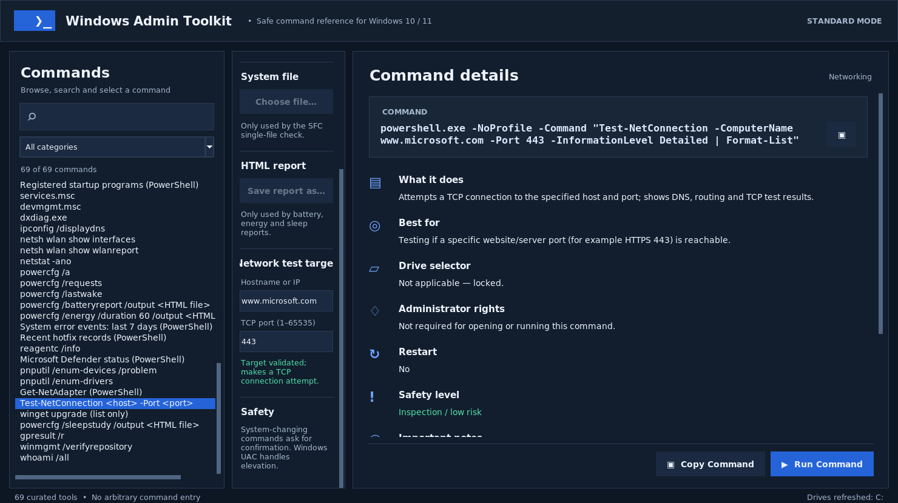

# Windows Admin Toolkit

**Public beta · v1.2.0-beta.1 · MIT licensed · Windows 10/11 · Python 3.10+**

A free, open-source Windows diagnostics and maintenance reference with a dark desktop GUI. Browse **69 curated built-in Windows commands** across **11 categories**, see what each does, choose a drive where appropriate, copy commands and request a guarded launch.

> **Beta warning:** Command previews, validation and graphical interactions have been tested on a Linux virtual display with simulated Windows launches. **Actual command execution, UAC behavior and the PyInstaller executable have not yet been verified on a real Windows PC.** Use a supervised pilot before distributing or trusting repairs. This software is provided without warranty.



## Detailed PDF Manual

The printable handbook explains **all 69 commands**, with practical usage instructions, safety classifications, examples, administrator and drive requirements, limitations, and Microsoft documentation links.

**[Read or download the Complete User Guide & Command Handbook (PDF)](docs/Windows_Admin_Toolkit_Detailed_Guide.pdf)**

The PDF is rebuilt automatically from `USER_MANUAL.md` and `COMMAND_REFERENCE.md` by the [documentation workflow](.github/workflows/publish-guide.yml).

## Main features

- **69 commands / 11 categories:** Windows file repair, DISM, disk health, RAM, startup/drivers, networking, Windows logs, power, battery and temporary files.
- **Easy navigation:** Search, category filter, keyboard shortcut `Ctrl+F`, scrollable command and details panels; source screenshot above is an actual Tkinter capture, not a mockup.
- **Drive picker:** Select a detected local drive (default `C:` when available); the picker locks when the current command doesn't accept a drive letter.
- **Plain-English guidance:** Explanation, best use, limitations, risk, administrator requirements and restart notes for each command.
- **User input controls:** SFC protected-file selection; HTML report destinations for Battery Report, Energy Report and SleepStudy; validated hostname/IP and TCP port for `Test-NetConnection`.
- **Safety:** Warnings before actions that write files, repair, reset or modify settings; Windows UAC for catalog items that need it. There is no arbitrary custom-command console.
- **TEMP cleanup:** A separate preview-only-first UI for old files in the current user's local TEMP area, no automatic selection, explicit confirmation and permanent deletion of selected files only.
- **No telemetry, accounts or external runtime packages** to launch the Python app. Some **Windows commands themselves** can use the internet (e.g. WinGet, DISM repair sources, and user-selected network tests).

## Run on Windows from source

1. Install **Python 3.10 or newer for Windows** (including Tcl/Tk). You can verify with `py -3 --version`.
2. Download the GitHub source ZIP and extract it into a normal folder (not inside the ZIP preview).
3. Double-click **`Start_Toolkit.pyw`**. Alternatively double-click **`Run_Windows_Admin_Toolkit.bat`** for a console-based start, or run `py -3 app.py` in the folder.
4. Select a command, read **What it does** and **Important notes**, change the drive/target if applicable, then use **Copy Command** or **Run Command**.
5. When the app displays a warning or Windows UAC dialog, review it before agreeing. Read the separate terminal window for actual results.

**Source dependencies:** Python standard library including Tkinter. No `pip install` is required to use the `.pyw` app. Use the ordinary Windows account; the app asks for elevated permission only when needed.

## Build a standalone EXE on Windows

Double-click **`Build_Windows_EXE.bat`** on a Windows PC. It installs a compatible PyInstaller 6.x version and builds `dist\WindowsAdminToolkit.exe`. The app icon is bundled.

An EXE builder is also included in [GitHub Actions](.github/workflows/windows-ci.yml). Its CI artifact is for **beta testing only**. **Neither local nor CI-compiled executables are signed or automatically verified for successful Windows command execution.** Do not disable SmartScreen, Defender or company security policies to run an unsigned binary.

## Command additions in 1.2.0 beta

| Command/tool | Purpose | Requirement / limitation |
|---|---|---|
| `pnputil /enum-devices /problem` | List devices with problem codes | Windows 10 1903+; admin requested |
| `pnputil /enum-drivers` | List third-party driver packages | Does not enumerate every active driver |
| `Get-NetAdapter` | Inspect adapter/link status | PowerShell NetAdapter module |
| `Test-NetConnection -ComputerName HOST -Port PORT` | Test TCP reachability to a selected host/port | User-entered hostname/IP and TCP port; outbound network request |
| `winget upgrade` | List available app upgrades | WinGet installed; can refresh online sources; **does not install** |
| `powercfg /sleepstudy /output FILE` | Generate Modern Standby HTML report | Modern Standby hardware; admin; creates/overwrites HTML |
| `gpresult /r` | Display effective Group Policy summary | Depends on user/elevation context and policy |
| `winmgmt /verifyrepository` | Check WMI repository consistency | Read-only diagnostic; admin requested; **never resets WMI** |
| `whoami /all` | Inspect current token, user/groups/privileges | Sensitive identity details in output |

## Safety and behavior

- **Read-only** commands are intended for inspection, not guaranteed to be harmless (they may collect system data, create connections or use CPU/disk).
- **Changing/reporting** commands display a confirmation before launch; a report destination can overwrite an existing HTML file.
- **Intensive** repairs (e.g. `chkdsk /r`, IP stack reset) require a stronger confirmation; backup and test in a disposable Windows environment first.
- **Never interpret a launched window as a successful repair.** Commands run outside the UI in their own Windows console or application, and exit codes are not captured by the toolkit.
- **Drive letters** only apply to volume-specific commands. `DISM /Online`, RAM checks, TEMP cleanup and physical-disk checks do not use the drive dropdown.
- **TEMP cleanup** is scoped to the signed-in user's `%LOCALAPPDATA%\Temp` and does not touch Downloads, Recycle Bin, Windows Update caches or folders outside that tree. Selected files are permanently deleted; no undo or Recycle Bin.
- **Availability differs** between Windows 10 and 11, system architecture, editions, managed PCs, software modules, hardware and access policies. This is not a compatibility guarantee.
- **Privacy:** Outputs from group policy, network, whoami, event logs, Wi-Fi reports and SFC target paths can contain personal or device information. Review before sharing.

## Documentation

- [User manual and walkthrough](USER_MANUAL.md) — full beginner-friendly guide.
- [All 69 commands and their explanations](COMMAND_REFERENCE.md) — syntax, purpose, limitations, permissions, drive behavior and source links.
- [Windows pilot test plan](WINDOWS_TEST_PLAN.md) — what remains to validate on real Windows PCs.
- [Audit and test report](AUDIT_REPORT.md) and [GUI test matrix](GUI_TEST_MATRIX.csv) — honest test coverage and gaps.
- [Changelog](CHANGELOG.md), [security policy](SECURITY.md), [contribution guide](CONTRIBUTING.md), [MIT license](LICENSE).

## Run tests

```powershell
py -3 -m unittest discover -s tests -v
py -3 -m compileall -q app.py command_catalog.py windows_launcher.py temp_cleaner.py tests
py -3 tests\smoke_gui.py
```

The unit suite runs automatically in Windows CI. The click-through tests (`tests/manual_exhaustive_gui.py`, `tests/manual_temp_cleaner_gui.py`) require an interactive GUI and use mocked system commands and disposable TEMP fixtures. `tests/capture_release_screenshot.py` is an optional **developer-only** helper requiring Pillow.

## Support / contributions

Please open GitHub Issues for reproducible bugs, Windows command compatibility notes and usability suggestions. **Do not post passwords, activation keys, recovery keys, complete logs containing personal information, or private network hostnames** in public issues.

The project code and documentation are released under the **[MIT License](LICENSE)**. Microsoft Windows utilities and related Microsoft content remain the property of their respective owners. This project is not affiliated with Microsoft.
